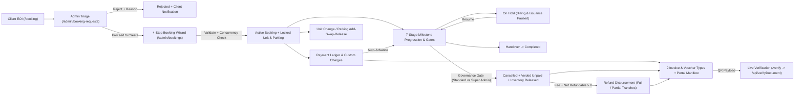
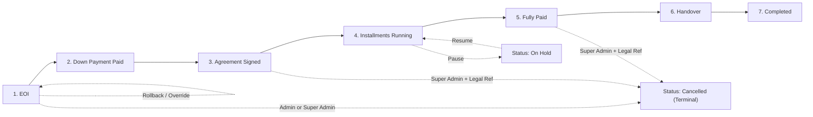
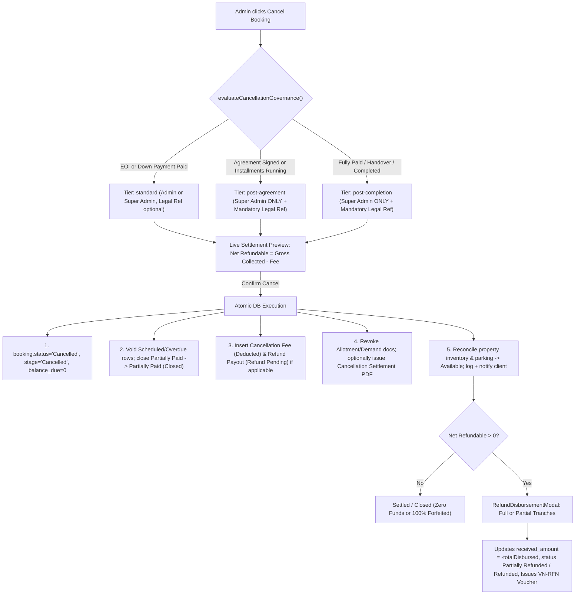
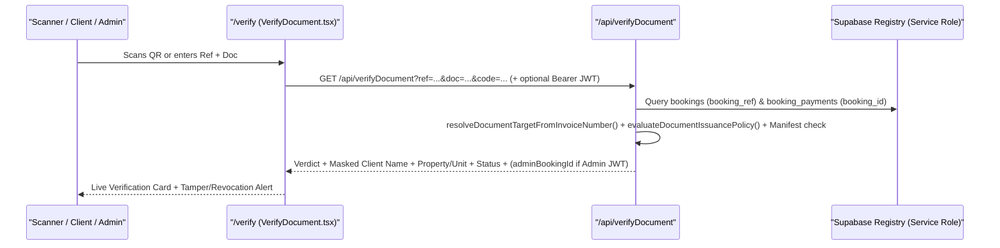

# Viridian Nexus — Booking Management System Handbook

> **Authoritative Architecture, Operations & Revision Reference**  
> **Platform:** Viridian Nexus Luxury Real Estate Platform (`typescript-migration`)  
> **Stack:** React 19 · Strict TypeScript · Vite 8 · Tailwind CSS 3 · Supabase (PostgreSQL, RLS, Realtime, Storage) · Serverless API (`/api/verifyDocument` on Vercel, Cloudflare Pages & Vite Dev)  
> **Scope:** 100% of the end-to-end Booking Management System — intake, asset locking, 7-stage milestone progression, payment ledger, mid-booking asset adjustments, enterprise cancellation & refund governance, client portal invoice release controls, A4 brochure PDFs, and live privacy-safe QR document verification.

---

## Table of Contents

1. [System Architecture & Codebase Map](#1-system-architecture--codebase-map)
2. [Roles, Permissions & Security (RLS + Session Enforcement)](#2-roles-permissions--security-rls--session-enforcement)
3. [Database Schema, Manifest Storage & Accounting Sign Conventions](#3-database-schema-manifest-storage--accounting-sign-conventions)
4. [End-to-End Booking Intake & Creation Pipeline](#4-end-to-end-booking-intake--creation-pipeline)
5. [Asset Locking, Concurrency Guard & Inventory Reconciliation](#5-asset-locking-concurrency-guard--inventory-reconciliation)
6. [7-Stage Milestone State Machine, Gates, Rollbacks & Overrides](#6-7-stage-milestone-state-machine-gates-rollbacks--overrides)
7. [Payment Ledger, Overdue Rules & Client Profile Sync](#7-payment-ledger-overdue-rules--client-profile-sync)
8. [Mid-Booking Unit & Parking Lifecycle](#8-mid-booking-unit--parking-lifecycle)
9. [Enterprise Cancellation Governance & Refund Settlement Lifecycle](#9-enterprise-cancellation-governance--refund-settlement-lifecycle)
10. [Invoicing, Brochure PDFs & Client Portal Release Governance](#10-invoicing-brochure-pdfs--client-portal-release-governance)
11. [Live Privacy-Safe QR Document Verification](#11-live-privacy-safe-qr-document-verification)
12. [Client Dashboard Experience](#12-client-dashboard-experience)
13. [Quick Revision Cheat Sheet, Legacy Notes & Test Suite Map](#13-quick-revision-cheat-sheet-legacy-notes--test-suite-map)

---

## 1. System Architecture & Codebase Map

The Booking Management System connects **four workspaces**:

1. **Client Intake (`/booking`)** — Authenticated client Expression of Interest (EOI) form showing live project inventory availability and parking capacity.
2. **Admin & Super Admin Operations (`/admin/booking-requests`, `/admin/bookings`, `/admin/bookings/:bookingId`)** — Request triage, 4-step booking creation wizard, atomic unit/parking locks, payment collection, 7-stage milestone gating, Super Admin overrides, client document release toggles, cancellation settlement, and refund disbursement.
3. **Client Dashboard (`/dashboard`, `/dashboard/booking/:bookingId`)** — Real-time view of linked bookings, payment history, settlement summaries (when cancelled), and read-only **Verified Invoices** authorized by Finance.
4. **Public & Admin QR Verification Desk (`/verify` + `/api/verifyDocument`)** — Live registry check for any printed/PDF invoice, receipt, statement, or refund voucher with strict PII masking for public scanners and a direct admin ledger shortcut for signed-in staff.

### High-Level End-to-End Flow



### Complete File & Module Map

| Layer | File | Responsibility |
| :--- | :--- | :--- |
| **Public & Client Pages** | `src/pages/Booking.tsx` | 3-step Expression of Interest (EOI) intake form at `/booking` |
| | `src/pages/Dashboard/Overview.tsx` | Client dashboard profile card, booked properties list & Verified Invoices trigger |
| | `src/pages/Dashboard/BookingDetail.tsx` | Real-time client booking progress, ledger table, cancelled settlement notice & verified docs |
| | `src/pages/VerifyDocument.tsx` | Live QR verification landing page & manual reference lookup at `/verify` |
| **Admin Pages & Modals** | `src/pages/Admin/BookingRequests.tsx` | Review, reject (with notification), or triage `booking_requests` |
| | `src/pages/Admin/Bookings.tsx` | Bookings KPIs, search/filters, and 4-step `NewBookingModal` creation wizard |
| | `src/pages/Admin/BookingDetailAdmin.tsx` | Master booking workspace + inline `PaymentModal`, `CustomPaymentModal`, `EditClientModal`, `ChangeUnitModal` |
| | `src/pages/Admin/StageAdvanceModal.tsx` | 7-stage milestone progression UI, prerequisite checklist, rollbacks & Super Admin override |
| | `src/pages/Admin/AddParkingModal.tsx` | Mid-booking parking addition, price/balance increase, optional add-on invoice & concurrency check |
| | `src/pages/Admin/ChangeParkingModal.tsx` | Balanced 1-for-1 mid-booking parking spot swap (zero price change) + concurrency check |
| | `src/pages/Admin/ReleaseParkingModal.tsx` | Mid-booking parking release, price/balance reduction & optional parking credit note |
| | `src/pages/Admin/CancelBookingModal.tsx` | Stage-gated cancellation modal, settlement math, Deed Rescission Ref, ledger voiding, manifest revocation & inventory release |
| | `src/pages/Admin/RefundDisbursementModal.tsx` | Single/multi-tranche refund payouts, 5 payout modes, Cash Voucher # generator, legacy cancelled settlement setup |
| **Invoice Rendering & Export** | `src/components/invoices/InvoicePreviewModal.tsx` | Interactive multi-tab document previewer, Admin Verify/Withhold controls, **Verify Page** link, Print & PDF download |
| | `src/components/invoices/BrochureInvoiceSheet.tsx` | Multi-page A4 brochure-themed corporate sheet with watermarks, QR box, BDT words & reconciliation block |
| | `src/utils/invoiceExport.ts` | Self-contained print CSS (`INVOICE_SHEET_STYLES`), QR PNG generator, logo/backdrop canvas caching, iframe Print & `html2canvas`/`jsPDF` export |
| **Pure Domain Engines** | `src/utils/bookingAllocation.ts` | Live asset lock snapshot (`computePropertyAllocationSnapshot`), dual-key matching, inventory reconciliation & concurrency conflict detection |
| | `src/utils/bookingStageGates.ts` | Canonical `STAGES` list & `evaluateStagePrerequisites()` rule engine |
| | `src/utils/bookingCancellation.ts` | Cancellation governance tiers, `computeCancellationSettlement()`, row classifiers & `VN-CXL` / `CV` ref generators |
| | `src/utils/invoiceBuilder.ts` | Builds all 9 `InvoiceDocument` types, South Asian BDT words (`numberToBDTWords`), overdue checks & A4 pixel-budget pagination |
| | `src/utils/invoicePolicy.ts` | Zero-Supabase pure policy engine (`evaluateDocumentIssuancePolicy`), manifest parser/writer & cancellation auto-revocation |
| | `src/utils/invoiceRelease.ts` | Supabase-backed `persistBookingInvoiceRelease()` + re-exports of `invoicePolicy.ts` |
| | `src/utils/documentVerification.ts` | QR URL builder (`buildDocumentVerificationUrl`), `maskClientName()`, `normalizeInvoiceRefCode()` & invoice-number resolver |
| | `src/utils/documentVerificationServer.ts` | Shared Fetch-standard server handler (`handleVerifyDocumentRequest`) powering `/api/verifyDocument` |
| | `src/utils/mappers.ts` | Snake-case DB <-> camelCase TypeScript mappers (`mapBookingFromDB`, `mapPaymentFromDB`, `mapActivityFromDB`, etc.) |
| | `src/types/index.ts` | Core TypeScript interfaces (`Booking`, `BookingPayment`, `PaymentStatus`, `BookingStage`, `BookingStatus`, `InventoryUnit`, `ParkingSpot`) |
| **Serverless & Routing** | `api/verifyDocument.ts` | Vercel serverless endpoint for `/api/verifyDocument` |
| | `functions/api/verifyDocument.ts` | Cloudflare Pages Function equivalent for `/api/verifyDocument` |
| | `vite.config.ts` | Local Vite dev middleware serving `/api/verifyDocument` via `loadEnv()` |
| | `vercel.json` | SPA rewrite rules excluding `/api/*` |
| | `src/App.tsx` | Route definitions & guards (`ProtectedUserRoute`, `ProtectedRoute`, `SuperAdminRoute`) |
| **Database** | `supabase_schema.sql` | PostgreSQL tables, RLS policies, `is_session_valid()`, triggers & RPC helpers |

---

## 2. Roles, Permissions & Security (RLS + Session Enforcement)

### Role Capability Matrix

| Capability | Public Visitor | Client (`user`) | Admin (`admin`) | Super Admin (`super_admin`) |
| :--- | :---: | :---: | :---: | :---: |
| Submit EOI (`/booking` -> `booking_requests`) | DB allows (`WITH CHECK (true)`) | Yes (`ProtectedUserRoute` at `/booking`) | Yes | Yes |
| View own linked bookings & payment ledger | No | Own `linked_user_id = auth.uid()` only | All bookings | All bookings |
| View `booking_activity_log` | No | **No (Admin-only RLS)** | Yes | Yes |
| Create bookings, record payments, edit KYC, change unit/parking | No | No | Yes | Yes |
| Advance stage when prerequisites are met / Rollback stage | No | No | Yes | Yes |
| **Bypass unmet stage gates (Stage Override)** | No | No | **No** | **Yes** (Checkbox + ≥8-char reason) |
| Cancel booking at `EOI` or `Down Payment Paid` | No | No | Yes | Yes |
| Cancel at `Agreement Signed`, `Installments Running`, `Fully Paid`, `Handover`, `Completed` | No | No | **No (Locked)** | **Yes** (+ mandatory Legal Ref) |
| Initialize legacy cancellation settlement & disburse refunds | No | No | Yes | Yes |
| Verify & Issue / Withdraw Client Portal documents | No | No | Yes | Yes |
| View & print/download Client Portal documents | No | **Only authorized docs** (`issued` / settled receipts) | All previewable docs | All previewable docs |
| Verify document authenticity via `/verify` & `/api/verifyDocument` | Yes (Masked PII, no notes) | Yes (Masked PII, no notes) | Yes + `Open Admin Ledger` shortcut (`adminBookingId`) | Yes + `Open Admin Ledger` shortcut (`adminBookingId`) |

### Database RLS & Session Validity (`supabase_schema.sql`)

- **`public.is_session_valid()`**: Server-side SQL guard used across all authenticated RLS policies:
  1. Verifies `auth.uid()` is present and extracts `session_id` UUID from `auth.jwt()`.
  2. Verifies the user exists in `public.profiles` with `is_banned = false`.
  3. Verifies the matching row in `auth.sessions` exists, is not expired (`not_after`), and was created within role age limits: **`24 hours`** for `admin`/`super_admin`, **`14 days`** for `user`.
- **Table Policies**:
  - `bookings` & `booking_payments`: Admins (`is_admin()`) have `FOR ALL`; clients have `FOR SELECT` only when `linked_user_id = auth.uid()` and `is_session_valid()`.
  - `booking_activity_log`: Strictly `is_admin()` for all operations — internal audit logs, override reasons, and staff cancellation notes are never readable by clients.
  - `booking_requests`: Public `INSERT` (`WITH CHECK (true)`), owner `SELECT` (`linked_user_id = auth.uid()`), admin `FOR ALL`.
  - `properties`: Public `SELECT`, admin `INSERT` / `UPDATE` / `DELETE`.
  - `notifications`: Client `SELECT` / `UPDATE` / `DELETE` on `user_id = auth.uid()`, admin `INSERT`.

> [!IMPORTANT]
> Client-side inactivity timeouts also enforce `7 days` for `user` and `2 hours` for `admin`/`super_admin` in `src/utils/sessionManager.ts` and `src/context/GlobalState.tsx`, paired with Supabase's server-side `is_session_valid()` check so stolen/logged-out JWTs are rejected at the database layer.

---

## 3. Database Schema, Manifest Storage & Accounting Sign Conventions

### Core Tables (`supabase_schema.sql`)

#### `public.bookings`
- **Identity & References:** `id` (UUID PK), `booking_ref` (e.g., `VN-2026-8687`), `created_at`, `updated_at`, `created_by`, `last_updated_by`.
- **Client Snapshot & Link:** `linked_user_id` (FK -> `profiles.id`), `client_id`, `client_name`, `client_email`, `client_phone`, `client_nid`, `client_address`.
- **Asset Allocation:** `property_id` (FK -> `properties.id`), `property_name`, `property_location`, `inventory_id` (matches `properties.inventory[].id`), `unit_number` (e.g., `"Floor 3, Unit 3A"`), `unit_type`, `parking_spot_ids` (JSONB array of `ParkingSpot.id`), `parking_included` (formatted display list e.g. `"P-3 (Ground)"`).
  - *Legacy/unused columns still present in DB/mapper:* `floor_number`, `parking_slot`, `parking_price` (parking charges roll into `total_price` / `balance_due` and ledger rows instead).
- **Financial Totals:** `total_price`, `total_paid`, `balance_due`, `down_payment_amount`, `installment_plan`.
- **Lifecycle:** `stage` (default `'EOI'`), `status` (default `'Active'`), `agreement_date`, `handover_date`.
- **Notes Separation:**
  - `bookings.notes`: Stores client-safe booking notes PLUS the embedded Client Portal Release Manifest HTML marker (`<!--VN_INVOICE_RELEASE:{...}-->`).
  - `bookings.internal_notes`: Stores **staff-only audit annotations** (cancellation reason + legal ref, Super Admin agreement ref, handover recipient/notes). Never shown to clients or returned by `/verify`.

#### Client Portal Release Manifest (`<!--VN_INVOICE_RELEASE:{...}-->`)
Embedded at the end of `bookings.notes` and managed by `src/utils/invoicePolicy.ts` / `invoiceRelease.ts`:

```json
{
  "version": 1,
  "bookingDocs": {
    "account-statement": {
      "status": "issued",
      "issuedBy": "Admin Name",
      "issuedById": "uuid-or-null",
      "issuedAt": "2026-11-24T06:00:00.000Z",
      "verificationCode": "VN-1A2B3C4"
    }
  },
  "paymentDocs": {
    "<payment_uuid>": {
      "paymentId": "<payment_uuid>",
      "category": "refund-voucher",
      "status": "issued",
      "issuedBy": "Admin Name",
      "issuedById": "uuid-or-null",
      "issuedAt": "2026-11-24T06:10:00.000Z",
      "verificationCode": "VN-5E6F7G8"
    }
  }
}
```
- `stripInvoiceReleaseManifestMarker()` cleanly removes the marker before showing any notes text in UI or PDFs.
- Verification codes (`VN-XXXXXXX`) are deterministic 32-bit FNV-1a base-36 hashes generated in `invoicePolicy.ts`.

#### `public.booking_payments`
- **Columns:** `id`, `booking_id` (FK cascade), `type`, `installment_number`, `scheduled_amount`, `received_amount`, `status`, `due_date`, `paid_date`, `payment_mode`, `recorded_by`, `notes`, `created_at`, `updated_at`.
- **All Supported `PaymentStatus` Values (`src/types/index.ts`):**
  - Active lifecycle: `'Scheduled'`, `'Overdue'`, `'Partially Paid'`, `'Paid'`, `'Waived'`
  - Cancellation & Refund lifecycle: `'Partially Paid (Closed)'`, `'Voided'`, `'Deducted'`, `'Refund Pending'`, `'Partially Refunded'`, `'Refunded'`

#### Ledger Accounting Sign & Field Conventions

| Ledger Entry Kind | `type` Example | `scheduled_amount` | `received_amount` | `status` | Meaning |
| :--- | :--- | :---: | :---: | :--- | :--- |
| Standard Obligation | `Down Payment`, `Installment`, `Add-on Invoice (Parking)`, custom charge | **Positive** (`> 0`) | `0` -> partial -> `>= scheduled` | `Scheduled` / `Overdue` / `Partially Paid` / `Paid` / `Waived` | Client obligation & realized remittance |
| Voided Obligation | *(any unpaid row on cancel)* | Positive (historical schedule preserved) | `0` | `Voided` | Permanently forgiven/nullified on termination (`netPayable = 0` in docs) |
| Closed Partial Payment | *(partial row on cancel)* | Positive | Positive (`< scheduled`) | `Partially Paid (Closed)` | Historical receipt remains valid for `received_amount`; remaining balance closed |
| Mid-Booking Parking Credit | `Credit Note (Parking Removed)` | **Negative** (`-deduct`) | **Negative** (`-deduct`) | `Paid` | Reduces contract `total_price` & `balance_due` after releasing parking |
| Cancellation Deduction | `Cancellation Fee` (`CANCELLATION_FEE_TYPE`) | **Positive** (`fee`) | `0` | `Deducted` | Portion of collected funds retained by company under cancellation settlement |
| Refund Obligation / Payout | `Refund Payout` (`REFUND_PAYOUT_TYPE`) | **Negative** (`-netRefundable`) | `0` -> **Negative** (`-disbursedSoFar`) | `Refund Pending` -> `Partially Refunded` -> `Refunded` | Outgoing refund payable to client; negative sign avoids inflating `grossCollected` |

> [!TIP]
> **Remember this rule:** When a booking is cancelled, **`bookings.total_paid` is NOT overwritten to 0** — it continues to preserve historical gross collected funds for receipts and reconciliation, while **`bookings.balance_due` is set to `0`** so the client owes zero future dues and refund tracking uses `computeCancellationSettlement(booking, payments)`.

#### Supporting Tables
- **`public.booking_activity_log`**: Immutable admin audit trail (`id`, `booking_id`, `type`, `message`, `actor_id`, `actor_name`, `metadata` JSONB, `created_at`).
- **`public.booking_requests`**: Public/authenticated EOIs (`id`, `property_id`, `property_name`, `linked_user_id`, `client_name`, `client_email`, `client_phone`, `unit_type`, `message`, `status`, `created_at`; plus optional `reject_reason`, `rejected_at`, `rejected_by` used in `BookingRequests.tsx`).
- **`public.properties`**: Holds `inventory` (`InventoryUnit[]`) and `parking_inventory` (`ParkingSpot[]`) JSONB arrays synchronized against live active bookings.
- **`public.notifications`**: Delivers booking confirmation, EOI rejection, and cancellation notices to `booking.linkedUserId`.

---

## 4. End-to-End Booking Intake & Creation Pipeline

### Step A — Client Expression of Interest (`src/pages/Booking.tsx` at `/booking`)
1. Protected by `<ProtectedUserRoute>` in `src/App.tsx` (requires signed-in client session).
2. Loads `properties` from `GlobalState`.
   - When a property defines `inventory`, only unit types with at least one `Available` unit appear; if none remain available, the project is flagged as **sold out** and progression is blocked.
   - Parking selector caps requested spots at `min(5, availableParkingCount)`.
3. **3-Step UI Flow:**
   - **Step 1 (`Select Property`)**: Choose project, unit type, optional parking spot count.
   - **Step 2 (`Your Details`)**: First/Last name, email, phone (`>= 10` chars), NID/Passport, current address (pre-filled from `userProfile`).
   - **Step 3 (`Confirmation`)**: Review summary & submit -> inserts row into `booking_requests` (`status: 'Pending Review'`, `linked_user_id: authUser?.id || null`, `message: "NID: ... | Address: ... | Parking: ..."`). Displays an 8-character uppercase reference (`#UUID_PREFIX`).

### Step B — Admin Request Triage (`src/pages/Admin/BookingRequests.tsx` at `/admin/booking-requests`)
- Real-time subscription on `booking_requests`.
- Supports search by client name, email, or property.
- For `Pending Review` items:
  - **Reject:** Prompts for rejection reason, updates `status = 'Rejected'`, stores `reject_reason` / `rejected_at` / `rejected_by`, and inserts a user notification if `linked_user_id` is present.
  - **Convert to Booking:** Navigates to `/admin/bookings` where an admin creates the formal booking via the 4-step wizard.

### Step C — 4-Step Direct Booking Wizard (`NewBookingModal` in `src/pages/Admin/Bookings.tsx`)
Draft form state persists temporarily in `sessionStorage` so accidental refreshes are recoverable, and clears on cancel/submit.

1. **Step 1 — Property, Unit & Parking:**
   - Fetches **live** `properties` + active `bookings` (`fetchFreshPropertyAndActiveBookings`) and renders only units & parking spots shown as free by `computePropertyAllocationSnapshot()`.
   - Blocks creation if the property has no exact `inventory` defined.
2. **Step 2 — Mandatory User Link & KYC:**
   - Searching by exact email against `profiles` and clicking **Confirm Link** is **mandatory** (`linked_user_id` required for Client Dashboard access & RLS scoping).
   - Auto-populates and validates `clientName`, `clientPhone`, `clientEmail`, `clientNidType` (`NID` / `Passport`), `clientNid`, and `clientAddress`.
3. **Step 3 — Financial Agreement & Installment Schedule:**
   - Auto-calculates Base Unit Price + (`parkingPrice * selectedSpots`) + `pricingAdjustment` (negative for discount, positive for markup) -> `totalPrice`.
   - Configures `downPaymentAmount` (`>= 0`, `<= totalPrice`), `installmentCount`, `installmentStartDate`, and `installmentFrequency`:
     - `Monthly` (+1m), `Bi-Monthly` (+2m), `Quarterly` (+3m), `Tri-Annual` (+4m), `Semi-Annual` (+6m), `Annual` (+12m).
4. **Step 4 — Review & Atomic Creation Sequence:**
   - Re-fetches fresh DB state and runs `validateUnitAssignment()` + `validateParkingAssignment()`.
   - Generates `bookingRef` (`VN-YYYY-XXXX`), inserts `bookings` (`stage: 'EOI'`, `status: 'Active'`, `total_paid: 0`, `balance_due: totalPrice`).
   - Runs **`detectConcurrentAllocationConflict(..., mode: 'insert')`**: if another concurrent admin won the same unit/parking spot earlier, the newly inserted booking is **immediately deleted (rolled back)** and an error toast is thrown.
   - Reconciles and persists `properties.inventory` (`Booked`) & `properties.parking_inventory` (`Assigned`).
   - Inserts `booking_activity_log` (`Booking created`).
   - Generates `booking_payments` rows:
     - Optional `Down Payment` (due in 14 days, status `Scheduled`) if `downPaymentAmount > 0`.
     - `Installment #1..N` evenly rounded to tens (`Math.round(remaining / count / 10) * 10`), placing rounding remainder on the final installment so the total sum matches `totalPrice - downPaymentAmount` exactly.
   - Sends a confirmation row to `notifications` for `linkedUserId`, clears wizard draft storage, and navigates to `/admin/bookings/:newBookingId`.

---

## 5. Asset Locking, Concurrency Guard & Inventory Reconciliation

Implemented in `src/utils/bookingAllocation.ts` so two admins can never double-book a unit or parking spot, and cancellations never leave stranded locks.

### Core Design Principles
1. **Authoritative Source of Truth:** Active bookings (`isActiveAllocationStatus(status)` = `status.toLowerCase() !== 'cancelled'`) are the master source of truth for asset ownership — not manually toggled property flags.
2. **Dual-Key Matching:** Prevents collisions caused by missing or differently formatted IDs by indexing BOTH:
   - Exact IDs: `inventory_id` and `parking_spot_ids[]`
   - Normalized physical keys:
     - Units: `buildUnitPhysicalKey(floor, unitName)` -> `"floor::unitname"` (also parsed from `bookings.unit_number` via `extractUnitPhysicalKeyFromBooking()`, ignoring `'TBD'`, `'Unassigned'`, `'N/A'`)
     - Parking: `buildParkingPhysicalKey(label, level)` -> `"label::level"` (plus fallback parsing of legacy `parking_included` text when `parking_spot_ids` is empty)
3. **Self-Healing & Manual Holds (`computePropertyAllocationSnapshot` & `reconcilePropertyInventoryWithBookings`):**
   - If a unit/spot has no active booking holder, a stale `'Booked'` unit or `'Assigned'` parking spot auto-heals back to `'Available'` on reconciliation.
   - Manual administrative holds (`status: 'On Hold'` in property inventory) without a booking remain locked and unavailable for booking.
4. **Property Editor Protection (`validatePropertyInventoryIntegrity`):**
   - Prevents Admins in `PropertyForm` from deleting, renaming floor/unit names, or forcing `Available` on any unit/parking spot currently locked by a non-cancelled booking.
5. **Post-Write Concurrency Race Detection (`detectConcurrentAllocationConflict`):**
   - Because Supabase multi-row checks happen without DB triggers locking JSONB arrays, every allocation write (`NewBookingModal`, `ChangeUnitModal`, `AddParkingModal`, `ChangeParkingModal`) re-queries all non-cancelled bookings for the property immediately after writing:
     - `mode: 'insert'`: deterministic tie-breaker (`createdAt` timestamp, then lexicographic `id`) lets the earliest writer win and rolls back/deletes later conflicting inserts.
     - `mode: 'update'`: immediately restores previous booking fields if any other active booking shares the same `inventoryId`, physical unit key, or parking spot ID.

---

## 6. 7-Stage Milestone State Machine, Gates, Rollbacks & Overrides

Implemented in `src/utils/bookingStageGates.ts` and `src/pages/Admin/StageAdvanceModal.tsx`.



*(Legacy compatibility: any older booking stored with `stage === 'Token Paid'` is treated identically to `'EOI'` across stage gating, cancellation governance, and auto-advancement.)*

### Exact Stage Gate Requirements (`evaluateStagePrerequisites`)

| Target Stage | Gate Requirements Checked | Side Effects / Metadata Saved |
| :--- | :--- | :--- |
| **1. `EOI`** | Initial stage on creation (reachable forward N/A, rollback allowed) | — |
| **2. `Down Payment Paid`** | Down Payment row is `Paid` (`received >= scheduled`), OR if no Down Payment row exists, `totalPaid >= downPaymentAmount`, OR `downPaymentAmount === 0` explicitly with no DP row. *(Offers quick-pay shortcut via `paymentIdToPay`)* | Auto-advances when `PaymentModal` clears Down Payment |
| **3. `Agreement Signed`** | Down Payment prerequisite settled (`isDownPaymentPaid`) | Records `bookings.agreement_date` and optional `[Agreement Ref: ...]` in `bookings.internal_notes` |
| **4. `Installments Running`** | Down Payment settled **AND** at least one ledger row with `type` starting with `'Installment'` exists | Auto-advances when `PaymentModal` pays an Installment in full |
| **5. `Fully Paid`** | `balanceDue <= 0` **AND** zero ledger rows have status outside `'Paid' | 'Waived'` | Auto-advances when `PaymentModal` brings `balance_due` to `0` |
| **6. `Handover`** | 100% financial clearance (`balanceDue <= 0` & all cleared/waived) **AND** Legal Agreement executed (`currentIndex >= Agreement Signed` or `agreementDate` present) | Records `bookings.handover_date` + `[Keys delivered to / Handover notes]` in `bookings.internal_notes` |
| **7. `Completed`** | Physical Handover completed (`currentIndex >= Handover` or `handoverDate` present) **AND** `balanceDue <= 0` | Records `bookings.handover_date` & handover notes if provided |

### Rollbacks, Executive Overrides & Status Switches
- **Stage Rollback:** Moving to any `targetIndex < currentIndex` is allowed with a clear warning banner; logged as `'Stage Rolled Back'`. Historical milestone audit logs remain intact.
- **Super Admin Executive Override:** Only `userProfile.role === 'super_admin'` sees the override unlock panel when `evaluation.allowed === false`. Requires:
  1. Checking the executive override confirmation box (`overrideAuthorized`), AND
  2. Entering a justification of at least **8 characters** (`overrideReason.trim().length >= 8`).
  - Logged as `'Stage Override (Super Admin)'` with full metadata (`previousStage`, `targetStage`, `isOverride`, `overrideReason`).
- **`On Hold` vs. `Active`:** Toggled from the `BookingDetailAdmin` header; logs `'Status Changed'`. While `On Hold`, upcoming payment prompts are hidden on Client Dashboard and demand invoice issuance / allotment re-issuance is blocked by `evaluateDocumentIssuancePolicy`.
- **`Cancelled`:** Terminal state — once cancelled, asset actions, stage advancement, payment collection, and resumption are permanently locked.

---

## 7. Payment Ledger, Overdue Rules & Client Profile Sync

All managed inside `src/pages/Admin/BookingDetailAdmin.tsx`:

- **`PaymentModal` (Record Payment):**
  - Supports **Full** (`receivedAmount >= scheduledAmount` -> status `'Paid'`) or **Partial** (`< scheduledAmount` -> status `'Partially Paid'`) receipts.
  - Payment modes: `Cash`, `Bank Transfer`, `Cheque`, `Mobile Banking` (`Mobile Banking (bKash/Nagad)`).
  - Combines Transaction Reference & Internal Note cleanly as `"Ref: <ref> | <note>"` so `extractReferenceFromNotes()` in `invoiceBuilder.ts` surfaces the Reference # automatically on receipts.
  - Recalculates `total_paid += delta` and `balance_due = max(0, total_price - newTotalPaid)`.
  - Runs automatic milestone progression (`EOI` -> `Down Payment Paid` / `Installments Running` / `Fully Paid`).
  - Optional checkbox (**"Verify & Issue Receipt to Client Portal"**, checked by default) updates the Client Portal Release Manifest atomically in the same update.
- **`CustomPaymentModal` (Add Custom Payment):**
  - Adds ad-hoc scheduled obligations (e.g., penalties, utility charges, custom installments) to `booking_payments` (`status: 'Scheduled'`) and increments both `bookings.total_price` and `bookings.balance_due`. Blocked on `Cancelled` bookings.
- **Overdue Detection Rules:**
  - `isPaymentOverdue()` in `invoiceBuilder.ts` returns `false` unconditionally for `Cancelled` bookings, `Voided`, `Partially Paid (Closed)`, `Deducted`, and refund rows; otherwise checks if `status === 'Overdue'` or (`status === 'Scheduled'` and `dueDate` end-of-day `23:59:59 < now`).
  - On `BookingDetailAdmin.tsx` & `Dashboard/BookingDetail.tsx` ledger tables, overdue rows show red `'Overdue'` badges (suppressed on cancelled, refund, and fee rows).
- **Client Profile Drift Detection & One-Click Sync (`EditClientModal` + Banner):**
  - `BookingDetailAdmin` fetches the linked `profiles` row (`linked_user_id`) and compares `Name`, `Phone`, `Email`, `NID/Passport`, and `Address`.
  - If the user updated their profile in `/dashboard`, an amber **"User Profile Has Updated"** card lists old vs. new values with a **Sync Profile** button (suppressed if booking is `Cancelled`), letting Admins bring the booking KYC snapshot up to date and logging `'Client Details Synced'`.

---

## 8. Mid-Booking Unit & Parking Lifecycle

All four operations are blocked once `booking.status === 'Cancelled'`.

| Operation | Modal Component | Contract Pricing & Ledger Impact | Concurrency & Reconciliation |
| :--- | :--- | :--- | :--- |
| **Change Unit** | `ChangeUnitModal` (in `BookingDetailAdmin.tsx`) | No automatic price change; updates `property_id`, `property_name`, `property_location`, `inventory_id`, `unit_type`, `unit_number` | Requires 2-step confirmation screen; live `validateUnitAssignment()` -> post-update `detectConcurrentAllocationConflict(mode: 'update')` with auto-rollback -> reconciles `properties.inventory` -> logs `'Unit Reassigned'` |
| **Add Parking** | `AddParkingModal.tsx` | Increases `total_price` & `balance_due` by editable amount (suggested `parkingPrice * spotCount`); if `adjustLedger` & amount > 0, appends `'Add-on Invoice (Parking)'` row (`Scheduled`) | Re-fetches fresh booking + property -> `validateParkingAssignment()` -> updates booking -> `detectConcurrentAllocationConflict(mode: 'update')` with rollback -> reconciles `parking_inventory` -> logs `'Parking Added & Price Adjusted'` |
| **Swap Parking** | `ChangeParkingModal.tsx` | Balanced **1-for-1 swap** (`spotsToRelease.length === spotsToClaim.length` and disjoint); **zero price/ledger change** | Validates released spots are still owned & new spots are free -> updates booking -> `detectConcurrentAllocationConflict(mode: 'update')` with rollback -> reconciles `parking_inventory` -> logs `'Parking Swapped'` |
| **Release Parking** | `ReleaseParkingModal.tsx` | Clears `parking_spot_ids: []` & `parking_included: null`; reduces `total_price` & `balance_due`; if `adjustLedger` & deduction > 0, inserts negative `'Credit Note (Parking Removed)'` row (`scheduled: -deduct`, `received: -deduct`, `Paid`) | Reconciles `parking_inventory` back to `Available` -> logs `'Parking Released & Price Adjusted'` |

---

## 9. Enterprise Cancellation Governance & Refund Settlement Lifecycle

Implemented in `src/utils/bookingCancellation.ts`, `src/pages/Admin/CancelBookingModal.tsx`, and `src/pages/Admin/RefundDisbursementModal.tsx`.



### Stage-Gated Cancellation Governance (`evaluateCancellationGovernance`)

| Booking Stage / Status | Governance Tier | Who Can Cancel? | Deed Rescission / Legal Ref # |
| :--- | :--- | :--- | :--- |
| Already `Cancelled` | `already-cancelled` | Nobody (Blocked) | N/A |
| `EOI` (or legacy `Token Paid`), `Down Payment Paid` | `standard` | **Admin or Super Admin** | Optional (can still enter or auto-generate) |
| `Agreement Signed`, `Installments Running` | `post-agreement` | **Super Admin ONLY** | **Mandatory** |
| `Fully Paid`, `Handover`, `Completed` (or `status === 'Completed'`) | `post-completion` | **Super Admin ONLY** | **Mandatory** |

- **Deed Rescission Reference # Input Guide:**
  - If a physical **Deed of Cancellation / Rescission** or Board Approval memo exists, type its exact registered/internal reference (e.g., `DEED-CXL-1042` or `RES-2026-09`).
  - If there is no registered deed ref (or using internal system tracking), click **Generate Ref** (`generateCancellationLegalRef`), which produces **`VN-CXL-YYYY-XXXX`** from the booking suffix (e.g., `VN-CXL-2026-8687`).

### Live Financial Settlement Math (`computeCancellationSettlement`)
- **Gross Collected:** Sum of `receivedAmount` across `isPositiveClientPaymentRow()` rows (falls back to `booking.totalPaid` if no positive rows exist).
- **Cancellation Fee:** Quick presets **`0%`**, **`5%`**, **`10%`** or any manual BDT amount clamped to `0 .. grossCollected`.
- **Net Refundable:** `max(0, grossCollected - cancellationFee)`.
- **Refund Remaining:** `max(0, netRefundable - refundDisbursed)`.

### Six Cancellation Settlement Statuses

| `settlementStatus` | Label Shown in UI | Trigger Condition |
| :--- | :--- | :--- |
| `no-payment-closed` | `Closed — Zero Funds Collected` | `grossCollected <= 0` |
| `forfeited` | `Settled — 100% Cancellation Deduction Applied` | `grossCollected > 0` and `netRefundable === 0` |
| `unsettled-legacy` | `Settlement Pending Setup` | Cancelled booking with `grossCollected > 0` and **no** `Refund Payout` row yet |
| `refund-pending` | `Refund Pending Disbursement` | `netRefundable > 0` and `refundDisbursed === 0` |
| `partially-refunded` | `Partially Refunded` | `0 < refundDisbursed < netRefundable` |
| `refunded` | `Refund Settled in Full` | `refundDisbursed >= netRefundable` |

### Refund Disbursement & Legacy Recovery (`RefundDisbursementModal.tsx`)
- **Multi-Tranche Support:** Finance can disburse the full remaining balance or partial tranches (e.g., ৳50,000 today, remaining ৳58,000 later). Each tranche appends a timestamped line to the `Refund Payout` row's notes, updates `received_amount = -(refundDisbursed + amount)`, and updates status to `'Partially Refunded'` or `'Refunded'`.
- **Retroactive Setup for Legacy Cancelled Bookings:** If a booking was cancelled before the settlement engine existed and has `grossCollected > 0` (`unsettled-legacy`), the same modal allows Finance to void leftover unpaid rows, close partial rows, specify any cancellation fee, create the `Refund Payout` schedule, optionally disburse immediately, and zero `balance_due`.
- **5 Payout Modes & Dynamic Reference Inputs (`getRefundPayoutRefMeta`):**

| Payout Mode | Input Field Label | Placeholder / Format | Auto-Generate Button? |
| :--- | :--- | :--- | :--- |
| `Bank Transfer (BEFTN/RTGS)` | `BEFTN / RTGS Transaction Ref` | `e.g. BEFTN-88412 or RTGS-20261124-091` | No (use bank trace ID) |
| `Account Payee Cheque` | `Cheque Number` | `e.g. CHQ-44109 or EBL-CHQ-44109` | No (use cheque leaf #) |
| `Pay Order` | `Pay Order Number` | `e.g. PO-2026-77312` | No (use bank PO/DD #) |
| `Mobile Banking (bKash/Nagad)` | `Mobile Banking TrxID` | `e.g. BKASH-9X4K2M8P` | No (use MFS TrxID) |
| `Cash` | `Cash Payment Voucher No.` | `e.g. CV-2026-8687` | **Yes — `Generate Voucher #` (`CV-YYYY-XXXX`)** |

- Optionally checks **"Verify & Issue Refund Voucher to Client Portal"** to publish the `VN-RFN-...` voucher immediately upon saving.

---

## 10. Invoicing, Brochure PDFs & Client Portal Release Governance

### All 9 Document Categories & Canonical Numbering (`src/utils/invoiceBuilder.ts`)

`normalizeInvoiceRefCode(bookingRef)` strips any leading `VN-` (so `VN-2026-8687` becomes `docRef = 2026-8687`), preventing duplicate prefixes like `VN-CXL-VN-...`.

| Scope | Category Key | Printed Document Title | Invoice Number Format |
| :--- | :--- | :--- | :--- |
| **Booking-Level** | `booking-summary` | `BOOKING ALLOTMENT INVOICE` | `VN-INV-{docRef}-MASTER` |
| **Booking-Level** | `account-statement` | `STATEMENT OF ACCOUNT` | `VN-STM-{docRef}` |
| **Booking-Level** | `outstanding-bundle` | `OUTSTANDING PAYMENT INVOICE` | `VN-DUE-{docRef}` |
| **Booking-Level** | `receipts-summary` | `CONSOLIDATED RECEIPT SUMMARY` | `VN-REC-SUM-{docRef}` |
| **Booking-Level** | `cancellation-settlement` | `CANCELLATION & FINAL SETTLEMENT` | `VN-CXL-{docRef}` |
| **Row-Level** | `payment-receipt` | `OFFICIAL PAYMENT RECEIPT` / `PARTIAL PAYMENT RECEIPT` | `VN-REC-{docRef}-{seq}` |
| **Row-Level** | `demand-invoice` | `PAYMENT DEMAND INVOICE` / `PARKING ADD-ON INVOICE` | `VN-INV-{docRef}-{seq}` |
| **Row-Level** | `credit-note` | `OFFICIAL CREDIT NOTE` / `WAIVER & ADJUSTMENT MEMO` | `VN-CN-{docRef}-{seq}` |
| **Row-Level** | `refund-voucher` | `OFFICIAL REFUND VOUCHER` / `REFUND SETTLEMENT ADVICE` | `VN-RFN-{docRef}-{seq}` |

- **Row Sequence Codes (`deriveSequenceCode`):** `DP` (Down Payment), `INS-01`..`INS-NN` (Installment #), `PK` (Parking add-on), `CR-PK` (Parking credit note), `RFN` (Refund payout), `FEE` (Cancellation fee), `TX-01`.. (other custom rows).

### Document Issuance Eligibility Matrix (`evaluateDocumentIssuancePolicy` in `src/utils/invoicePolicy.ts`)

Legend: **Yes** = allowed, **Prev Only** = Admin preview allowed but Client Portal issuance locked, **Blocked** = hidden/blocked for both Admin & Client.

| Document Type | Active (`Due > 0`) | `On Hold` | Fully Paid (`Due = 0`) | Cancelled (`৳0 Paid`) | Cancelled (`> ৳0 Paid`) |
| :--- | :---: | :---: | :---: | :---: | :---: |
| **Allotment Invoice** (`booking-summary`) | **Yes** | **Prev Only** *(issuance paused; already-issued stays visible)* | **Yes** | **Blocked** *(auto-revoked)* | **Blocked** *(auto-revoked)* |
| **Statement of Account** (`account-statement`) | **Yes** | **Yes** | **Yes** | **Yes** *(marked Cancelled)* | **Yes** *(includes Settlement Box)* |
| **Outstanding Invoice** (`outstanding-bundle`) | **Yes** | **Prev Only** | **Prev Only** *(৳0 balance)* | **Blocked** *(auto-revoked)* | **Blocked** *(auto-revoked)* |
| **Receipts Summary** (`receipts-summary`) | **Yes** *(if collected > 0)* | **Yes** *(if collected > 0)* | **Yes** | **Blocked** *(৳0 collected)* | **Yes** *(Historical Receipts)* |
| **Cancellation Settlement** (`cancellation-settlement`) | **Blocked** | **Blocked** | **Blocked** | **Yes** | **Yes** |
| **Payment Receipt** (`Paid` / `Partial` / `Partial (Closed)`) | **Yes** | **Yes** | **Yes** | N/A | **Yes** *(Historical Receipt)* |
| **Demand Invoice** (`Scheduled` / `Overdue` / unpaid `Partial`) | **Yes** | **Prev Only** | N/A | **Blocked** *(auto-revoked)* | **Blocked** *(auto-revoked)* |
| **Credit Note / Waiver Memo** (`scheduled < 0` or `Waived`) | **Yes** | **Yes** | **Yes** | **Yes** | **Yes** |
| **Voided Row** (`Voided`) | N/A | N/A | N/A | **Blocked** | **Blocked** |
| **Cancellation Fee Row** (`Deducted`) | N/A | N/A | N/A | N/A | **Blocked** *(shown inside Settlement Statement)* |
| **Refund Advice** (`Refund Pending`, ৳0 disbursed) | N/A | N/A | N/A | N/A | **Prev Only** *(must disburse first)* |
| **Official Refund Voucher** (`Partially Refunded` / `Refunded`) | N/A | N/A | N/A | N/A | **Yes** |

### Client Portal Authorization Rules & Defense in Depth
- **Booking-level documents** (`booking-summary`, `account-statement`, `outstanding-bundle`, `receipts-summary`, `cancellation-settlement`) appear in the Client Dashboard **only** if explicitly marked `'issued'` by Admin/Super Admin AND permitted by `evaluateDocumentIssuancePolicy()`.
- **Settled positive payment receipts** (`Paid`, `Partially Paid`, `Partially Paid (Closed)` with `receivedAmount > 0`) are **auto-authorized** for Client Portal visibility (`'Viridian Nexus Finance'`) unless Admin explicitly toggles them to `'withheld'`.
- **Automatic Revocation on Cancellation (`revokeActiveDocsOnCancellation`):** Withdraws `'booking-summary'`, `'outstanding-bundle'`, all unpaid/`Voided` `demand-invoice` items, and `'receipts-summary'` (if gross collected is ৳0), while preserving historical Statements of Account, settled Payment Receipts, and Credit Notes.
- **4-Layer Enforcement:** Policy is checked in (1) Admin UI (`BookingDetailAdmin`, `InvoicePreviewModal`), (2) `persistBookingInvoiceRelease()` (throws before DB write), (3) Client Dashboard filtering, and (4) live `/api/verifyDocument` verification responses.

### Corporate Sheet Styling & PDF Pagination (`BrochureInvoiceSheet.tsx` + `invoiceExport.ts`)
- **Audience Isolation:** Passing `audience: 'client'` strips internal staff row `notes` from particulars subtitles and remarks.
- **Visual Cues for Cancelled Bookings:** Diagonal `CANCELLED` (or `VOIDED` on voided demand previews) watermark across every sheet, `(Released)` tag appended to unit and parking labels, and a dedicated Cancellation & Settlement Summary card.
- **BDT Words:** `numberToBDTWords()` renders South Asian **Crore / Lac / Thousand Taka Only** phrasing.
- **A4 Pixel-Budget Pagination (`paginateInvoiceItems`):** Formats exact `794px x 1123px` A4 sheets (`singlePageBudgetPx: 432`, `firstPageBudgetPx: 615`, `middlePageBudgetPx: 892`, `lastPageBudgetPx: 710` minus dynamic header/footer line estimates).
- **Exports:** Supports isolated browser **Print / Save PDF** (`printInvoiceElement` using pre-rendered chartreuse canvas backdrop PNG + Base64 logo) and direct client-side **PDF download** (`downloadInvoicePdf`).

---

## 11. Live Privacy-Safe QR Document Verification

Implemented across `src/utils/documentVerification.ts`, `src/utils/documentVerificationServer.ts`, `src/pages/VerifyDocument.tsx`, `api/verifyDocument.ts`, `functions/api/verifyDocument.ts`, and `vite.config.ts`.

### How It Works



### Scannable QR Payload Format
Every generated `InvoiceDocument` encodes:
```text
https://<origin>/verify?ref=<bookingRef>&doc=<invoiceNumber>&code=<verificationCode>
```
- When Finance has issued the document (or it is an auto-authorized settled receipt), `Verify Code: VN-XXXXXXX` is printed on the sheet and `&code=VN-XXXXXXX` is baked into the QR payload.
- **Backward Compatibility:** `resolveDocumentTargetFromInvoiceNumber()` matches both the clean format (`VN-CXL-2026-8687`) and legacy double-prefix sheets printed earlier (`VN-CXL-VN-2026-8687`).

### All 6 Verification Verdicts (`DocumentVerificationVerdict`)

| Verdict | UI Badge & Meaning | When Returned |
| :--- | :--- | :--- |
| **`VERIFIED`** | Authentic · Verified | Booking & document exist, policy allows client issuance, not withheld, issued by Finance (and `code` matches if supplied) |
| **`VERIFIED_HISTORICAL_CANCELLED`** | Historical Receipt · Booking Cancelled | Authentic historical `payment-receipt` or `receipts-summary`, but booking was later cancelled — directs verifier to the Cancellation Settlement Statement for refund status |
| **`UNISSUED_DRAFT`** | Unissued Draft | Valid booking & document match, allowed by policy, **not yet formally verified & issued** by Finance (hides amount field) |
| **`REVOKED`** | Document Revoked / Withdrawn | Booking status invalidates document (e.g., cancelled Allotment or Demand Invoice -> shows amount context) **OR** Finance explicitly marked it `withheld` (hides amount) |
| **`INVALID_CODE`** | Verification Code Mismatch | Supplied `code` fails regex or differs from the registry code — warns of possible document alteration (`document: null`) |
| **`NOT_FOUND`** | Not Found / Invalid Request | Invalid request parameters (`400`), unknown `booking_ref`, or unmatched `invoiceNumber` |

### Privacy, Anti-Abuse & Hosting Parity
- **Zero PII Leak:** Public scanners only ever see `maskClientName()` (e.g., `"Rahim Chowdhury"` -> `"R***m C*******y"`), project name/location, masked unit summary, status, stage, and document total (for valid/revoked-policy docs). Email, phone, NID, address, and internal staff notes are **never serialized** in the API response.
- **Security Headers & Input Guards:** `cache-control: no-store`, strict token regex `^[A-Za-z0-9._-]+$` (max 80 chars), SEO `<meta name="robots" content="noindex, nofollow">` on `/verify`.
- **Admin Ledger Shortcut:** When a logged-in `admin` or `super_admin` (non-banned) scans/opens `/verify` or clicks **Verify Page** inside `InvoicePreviewModal`, `VerifyDocument` forwards their Supabase Bearer JWT and `/api/verifyDocument` returns `adminBookingId`, unlocking a direct **Open Admin Booking Ledger** button.
- **Deployment Parity & Pure Shared Module Split:**
  - `src/utils/invoicePolicy.ts` was deliberately separated from `src/utils/invoiceRelease.ts` (and uses `.js` relative import specifiers across `bookingCancellation.ts`, `invoiceBuilder.ts`, `documentVerification.ts`, `documentVerificationServer.ts`, `mappers.ts`) so **Vercel** (`api/verifyDocument.ts`), **Cloudflare Pages** (`functions/api/verifyDocument.ts`), and **Vite dev middleware** (`vite.config.ts`) execute the exact same pure verification logic without pulling in the browser-only `import.meta.env` Supabase client.
  - Requires server-side env vars: `SUPABASE_URL` (or `VITE_SUPABASE_URL`) and `SUPABASE_SERVICE_ROLE_KEY`.

---

## 12. Client Dashboard Experience

- **`Overview.tsx` (`/dashboard`):**
  - Displays personal KYC card & **Edit Profile** modal (`EditProfileModal.tsx`).
  - Lists all bookings where `linked_user_id === userProfile.uid` with real-time Supabase updates.
  - Shows `(Released)` next to unit/parking labels on cancelled bookings and displays a **`Verified Invoices (N)`** button whenever at least 1 document is client-authorized.
- **`BookingDetail.tsx` (`/dashboard/booking/:bookingId`):**
  - Verifies `booking.linkedUserId === userProfile.uid` before rendering.
  - Shows the 7-stage progress bar when Active/On Hold/Completed — OR replaces it with a comprehensive **Booking Cancelled** banner showing `settlementStatusLabel`, `Total Collected`, `Deduction / Fee`, `Net Refundable`, `Refund Remaining`, and a 1-click button for the issued **Cancellation & Settlement Statement**.
  - Renders the client's real-time Payment History table (`Scheduled`, `Overdue` if active, `Paid`, `Partially Paid`, `Partially Paid (Closed)`, `Voided`, `Deducted`, `Refund Pending`, `Partially Refunded`, `Refunded`) alongside per-row **Verified** document buttons (only for authorized rows).
  - Opens `InvoicePreviewModal` with `audience="client"`, using `resolveDefaultClientDocumentSelection()` (`cancellation-settlement` first when cancelled; `account-statement` first when active).

---

## 13. Quick Revision Cheat Sheet, Legacy Notes & Test Suite Map

### Top 10 "Must Remember" Rules
1. **Bookings control inventory, not reverse:** Active (`status !== 'Cancelled'`) bookings are the ground truth for `computePropertyAllocationSnapshot()` and `reconcilePropertyInventoryWithBookings()`.
2. **Physical keys block double-booking:** Units are matched by both `inventoryId` and `floor::unitName`; parking by `spotId` and `label::level`.
3. **All allocations verify post-write concurrency:** `NewBookingModal`, `ChangeUnitModal`, `AddParkingModal`, and `ChangeParkingModal` call `detectConcurrentAllocationConflict()` immediately after mutating and auto-roll back collisions.
4. **7 stages (not 8):** `EOI` -> `Down Payment Paid` -> `Agreement Signed` -> `Installments Running` -> `Fully Paid` -> `Handover` -> `Completed` (legacy `'Token Paid'` normalizes to `'EOI'`).
5. **Super Admin exclusives in booking domain:** Executive Stage Gate Overrides (`>= 8`-char justification) AND Cancellation at `Agreement Signed` through `Completed` (with mandatory Legal Ref).
6. **Balance due becomes 0 on cancel, `total_paid` stays preserved:** Preserves gross collected receipts while wiping client debt; all refunds use negative `Refund Payout` rows (`scheduled_amount = -netRefundable`, `received_amount = -disbursed`).
7. **Three notes channels exist:** `bookings.internal_notes` (private staff memos), `bookings.notes` stripped (client-safe notes), and `<!--VN_INVOICE_RELEASE:{...}-->` (tamper-hashed client release manifest).
8. **Receipts auto-issue, master docs require manual issue:** Settled positive receipts auto-authorize unless marked `withheld`; `Allotment`, `Statement`, `Outstanding`, `Receipts Summary`, `Cancellation Settlement`, and `Refund Vouchers` require explicit issuance.
9. **Cancellation auto-revokes forward docs:** Unpaid demand invoices, `Outstanding Invoice`, and `Allotment Invoice` are automatically withheld and blocked from issuance/QR verification upon cancellation.
10. **QR Verification is live & privacy-safe:** `/api/verifyDocument` reads live Postgres via service role, applies `evaluateDocumentIssuancePolicy()`, returns 1 of 6 verdicts (`VERIFIED`, `VERIFIED_HISTORICAL_CANCELLED`, `UNISSUED_DRAFT`, `REVOKED`, `INVALID_CODE`, `NOT_FOUND`), and masks client names publicly.

### Legacy & Migration Notes
- **Historical `docs/TEST_CASES_BOOKING_SYSTEM.md`:** Written earlier (October 2026) and references an older 8-stage numbering (`Token Paid` as Stage 2) and older pre-invoice/cancellation flows. Treat the current live code and this handbook as canonical for the 7-stage model, cancellation/refund governance, and `/verify` QR verification.
- **Unused Legacy Booking Columns:** `token_amount`, `floor_number`, `parking_slot`, and `bookings.parking_price` exist from early schema drafts; live code ignores them in favor of `down_payment_amount`, `unit_number`, `parking_spot_ids`, `parking_included`, and `total_price`.
- **Legacy Cancelled Bookings:** Pre-upgrade cancelled bookings that collected money without a `Refund Payout` row automatically surface as `Settlement Pending Setup` (`unsettled-legacy`) with an **Initialize Settlement / Refund** button in `BookingDetailAdmin.tsx`.

### Booking Test Suite & Verification Commands

| Test File | What It Verifies |
| :--- | :--- |
| `tests/booking/bookingAllocation.test.ts` | Physical key extraction, availability snapshots, orphan lock self-healing, inventory integrity & parking assignments |
| `tests/booking/bookingCancellation.test.ts` | Stage governance tiers, fee/net-refundable calculations, settlement statuses, `VN-CXL` & `CV` generators, 5 payout ref modes |
| `tests/booking/documentVerification.test.ts` | QR URL builder, name masking, clean vs. legacy ref resolution, all 6 verification verdicts, Bearer admin shortcut & PII redaction |
| `tests/booking/invoiceBuilder.test.ts` | All 9 document templates, BDT Crore/Lac words, overdue logic, audience note stripping, A4 pixel pagination |
| `tests/booking/invoiceRelease.test.ts` | Manifest parsing/merging, `evaluateDocumentIssuancePolicy` matrix, cancellation revocation, client authorization defaults |
| `tests/admin/directBooking.test.ts` | Direct booking creation validation & installment schedule generation |
| `tests/admin/paymentAndLedger.test.ts` | Full/partial payment ledger math, balance recalculation & stage auto-advance |
| `tests/admin/parkingAndInventoryLifecycle.test.ts` | Mid-booking parking add, balanced 1-for-1 swap, release & credit notes |
| `tests/admin/stageGatesAndRollback.test.ts` | Forward stage prerequisite gates & stage rollback checks |
| `tests/superadmin/stageOverrideAndSecurity.test.ts` | Super Admin stage gate overrides, justification length checks & non-super-admin denial |
| `tests/user/userBooking.test.ts` | Client EOI submission, dashboard booking access & client isolation rules |
| `tests/edgeCases/concurrencyAndIntegrity.test.ts` | Concurrent booking & unit/parking race conflict resolution |

Run full verification across TypeScript, linting, unit tests, and production bundling:

```powershell
npx.cmd tsc --noEmit
npm.cmd run lint
npm.cmd test
npm.cmd run build
```
